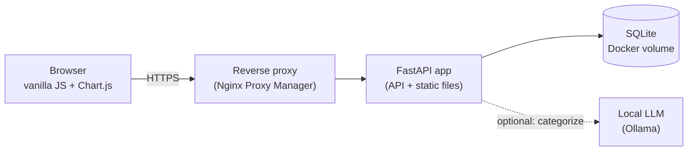

# Household Finance Dashboard

A self-hosted, privacy-first budgeting tool for two people. It imports bank and credit-card CSV exports, sorts every transaction into categories
(rules first, a **local** AI model second), and shows where the money goes, what is being saved, and what future plans like a house or a child
will do to the picture. Nothing leaves the home network: no bank logins, no cloud AI, no third-party analytics.

> **Status: in active development** (last updated 2026-10-29). The backend foundation is built and tested; the web UI, budgets, goals and forecasting are next.
> See [Status](#status) for exactly what works today.

## Why I built it
Off-the-shelf budgeting apps want bank credentials and send data to the cloud, and none of them handle a *joint + personal* setup well. I wanted:

- **Joint and personal views.** Our shared accounts are visible to both of us; my personal accounts must never show up in the joint view, and vice versa.
- **Numbers I can trust.** Card payments, transfers between our own accounts and savings moves must not be counted as spending (a common double-counting bug).
- **Local AI categorization** that learns from my corrections.
- **Plain forecasting.** What happens to our savings if we buy a home or have a child, with no interest or APY assumptions.

## Design highlights
*Some rows describe the target design; the [Status](#status) table shows what is implemented today.*

| Problem | How it is handled |
|---|---|
| Privacy between users | Every query is filtered by an account-owner *scope* (`joint` / `personal` / `combined`) on the **server**. Tests assert user B can never read, change or delete user A's personal data through any endpoint. |
| Double counting | Categories have a *kind* (income, expense, transfer, savings, reimbursement). Only `expense` counts as spending, so credit-card payments and transfers between accounts never inflate totals; employer reimbursements for work purchases are netted out separately. |
| Messy bank exports | A CSV parser for Wells Fargo and AMEX formats: credit-card sign inversion, pending rows skipped, quoted fields, tab or comma delimiters. Validated against 1,000+ real transactions locally with zero parse errors. |
| Safe re-imports | Each row gets a deterministic key that includes an occurrence index, so importing the same file twice adds nothing while genuinely identical same-day charges are both kept. |
| Categorization | 1) editable keyword rules (longest match wins, optional amount ranges); 2) a local LLM suggests a category with a confidence score for the rest; 3) a manual fix can create a new rule, so the system gets better with use. Manual choices are never overwritten. |
| Money correctness | All money is stored as integer cents. Dates, goal ETAs and forecasts are computed in code, never by the LLM. |
| Degrades gracefully | If the AI model is offline, rules still work and the app tells the user instead of failing. |

## Architecture

One small Python process serves both the JSON API and the static front end. There is no build step and no ORM, so the whole thing is easy to read and to run.

## Tech stack
Python 3, FastAPI, SQLite (standard library), pytest, httpx, plain HTML/CSS/ES modules, Chart.js, Docker Compose, Ollama (local LLM).

## Status
| Area | State |
|---|---|
| Project scaffold, config, health check | Done |
| SQLite schema and seed data (categories, rules) | Done |
| Authentication (scrypt hashes, DB-backed sessions, login lockout) | Done |
| Scoped accounts API (joint / personal) with privacy tests | Done |
| CSV parser (Wells Fargo, AMEX) and import endpoint with de-duplication | Done |
| Transactions API (filters, pagination, manual categorization) | Done |
| Rules engine, categories and rules APIs | In progress |
| "Learn from corrections", spending summary API | Planned |
| Local LLM categorizer | Planned |
| Budgets, goals with estimated completion dates, forecast | Planned |
| Web UI (home, transactions, budgets, goals, forecast, accounts, rules) | Planned |
| Docker deployment, backups, hardening pass | Planned |

Roughly 46 automated tests pass as of the last update. No real financial data is stored in this repository; development uses small fake fixtures.

## How it is being built
This project is also an experiment in **spec-driven development with a local coding agent**:

- [`SPEC.md`](SPEC.md) is the single source of truth: data model, API contract, definitions (what counts as spending) and math rules.
- [`AGENTS.md`](AGENTS.md) holds the rules the agent follows every session: one task per session, tests first, small files, no real data.
- [`tasks/`](tasks) contains about 30 small task files, each with exact files, steps and a verification command. [`PROGRESS.md`](PROGRESS.md) tracks them.
- A 27B-parameter model running locally through Ollama and the Pi coding agent implements one task per fresh session and commits when its tests pass. Session logs and code are reviewed after each task.
- Lessons so far: tasks must be sized by *component*, not by line count (one that was too big stalled the agent, and I split it into six); tasks must carry their own context; and the agent's code needs a human-style review (one review caught a login-throttling weakness, a lockout checked after the password, which was then fixed).

Details and tuning notes: [`docs/BUILD_KIT.md`](docs/BUILD_KIT.md).

## Run it locally
```bash
make setup     # create .venv and install dependencies
make test      # run the test suite
make dev       # start the API on http://localhost:8000  (the web UI arrives with the frontend tasks)
```
Configuration is via environment variables; see [`.env.example`](.env.example). Deployment is a Docker Compose stack behind a reverse proxy
(see `docker-compose.yml` once the deployment task lands).

## Project layout
```
app/            FastAPI app: auth, scope rules, CSV parser, routers (accounts, imports, transactions, ...)
app/schema.sql  SQLite schema          app/seed/   starter categories and rules
tests/          pytest suite and fixtures (fake data only)
tasks/          small, verifiable build tasks for the coding agent
assets/         ready-made files the tasks copy (Docker, deploy scripts, fixtures)
```

## Security notes
Passwords are hashed with scrypt; sessions are server-side with HttpOnly, SameSite cookies; failed logins are rate-limited per IP; every endpoint
except login and health requires authentication; data-scope checks are enforced on the server and covered by tests.

## About
Built by Mohamed. <!-- add your GitHub / LinkedIn / email here -->

<!-- add a license line here once you pick one -->
